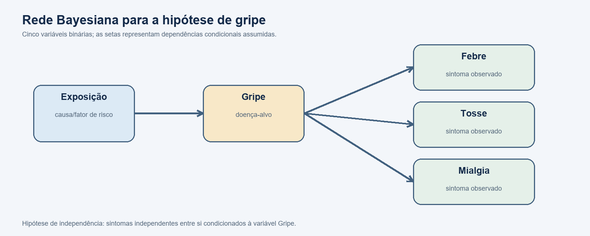

## 8. Sistema de Diagnóstico Médico Utilizando Redes Bayesianas

Para representar o raciocínio diagnóstico sob incerteza modelamos uma Rede Bayesiana voltada para a avaliação de síndrome gripal contendo cinco variáveis binárias: Exposicao (fator de risco epidemiológico indicando contato recente), Gripe (doença principal a ser diagnosticada) e três sintomas observáveis que são Febre, Tosse e Mialgia. A estrutura causal assume que a exposição prévia influencia a probabilidade de contrair gripe, enquanto a presença ou ausência de gripe condiciona diretamente o surgimento de febre, tosse e dor muscular. Dado o estado da variável Gripe os três sintomas são considerados condicionalmente independentes entre si e também independentes da exposição inicial.

| Variável (Nó) | Pais na Rede | Tabela de Probabilidade Condicional (CPT) |
|***|***|***|
| Exposicao | Nenhum | P(Exposicao = sim) = 0,25 ; P(Exposicao = não) = 0,75 |
| Gripe | Exposicao | P(Gripe = sim | Exposicao = sim) = 0,20 ; P(Gripe = sim | Exposicao = não) = 0,04 |
| Febre | Gripe | P(Febre = sim | Gripe = sim) = 0,80 ; P(Febre = sim | Gripe = não) = 0,08 |
| Tosse | Gripe | P(Tosse = sim | Gripe = sim) = 0,70 ; P(Tosse = sim | Gripe = não) = 0,20 |
| Mialgia | Gripe | P(Mialgia = sim | Gripe = sim) = 0,75 ; P(Mialgia = sim | Gripe = não) = 0,05 |

A implementação em Python realiza inferência exata por enumeração sobre a distribuição conjunta fatorada da rede. Partindo das probabilidades a priori sem nenhuma evidência observada a probabilidade marginal inicial da doença é P(Gripe = sim) = 0,25 x 0,20 + 0,75 x 0,04 = 0,0800 (8,00 por cento). Realizamos os experimentos inserindo evidências progressivamente: no Cenário 1 com Febre igual a sim a probabilidade a posteriori sobe para 0,4651 pois a febre é muito mais frequente na presença de gripe do que sem ela; no Cenário 2 acrescentando Tosse igual a sim a probabilidade atualiza para 0,7527; e no Cenário 3 com Febre, Tosse e Mialgia todas positivas a probabilidade a posteriori atinge 0,9786.

Em comparação com sistemas baseados apenas em regras rígidas as Redes Bayesianas oferecem a vantagem de tratar evidências parciais ou incompletas de maneira gradual atualizando a crença diagnóstica sem travar quando falta algum sintoma. Como limitações desta modelagem didática destacam se o uso de variáveis estritamente binárias a presença de uma única doença alvo e a suposição de independência condicional entre todos os sintomas. Para tornar o modelo mais realista em ambiente clínico seria indicado acrescentar diagnósticos diferenciais como resfriado e alergia, incluir variáveis de faixa etária e vacinação e calibrar as tabelas com dados epidemiológicos reais. Todos os arquivos código diagrama e a apresentação em slides Questao_08/apresentacao_demonstracoes.pptx estão na pasta Questao_08.
